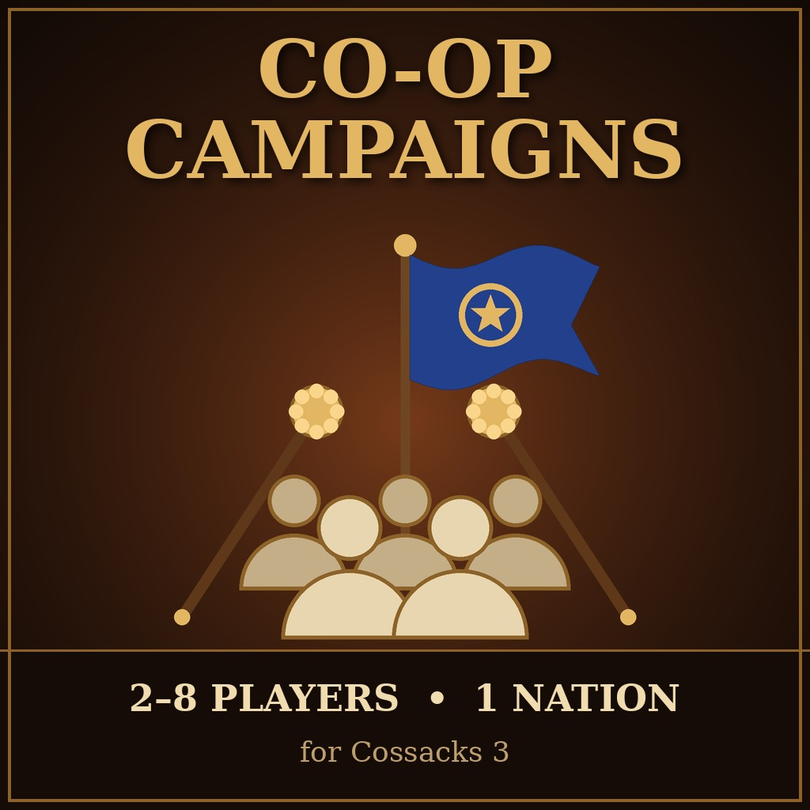

<h1 align="center">⚔️ Coop Campaigns for Cossacks 3</h1>

<p align="center">
  
  
  
  
  
</p>

<p align="center">
  Play the <b>campaign missions of Cossacks 3 together</b>: 2–8 players command one nation.<br>
  One army, one economy, several hetmans.
</p>

<p align="center">
  <a href="https://steamcommunity.com/sharedfiles/filedetails/?id=3830825914"></a>
</p>

<p align="center">
  
</p>

---

## ⚔️ Why Coop Campaigns?

Cossacks 3 has five historical campaigns and more in its DLC, but they are single-player only: the game's
co-op is limited to skirmishes against the AI. Coop Campaigns puts every campaign mission into a
multiplayer room. All players control the campaign's nation, and the mission runs exactly as in
single player: scripts, objectives, allies, enemies and the hero you must keep alive.

---

## 📸 Screenshots

<p align="center">
  
  <br>
  <sub><b>Co-op room</b> · campaign and mission pickers, briefing, Load save</sub>
</p>

<table align="center">
  <tr>
    <td align="center" valign="middle" width="55%">
      
    </td>
    <td align="center" valign="middle" width="45%">
      
    </td>
  </tr>
  <tr>
    <td align="center"><sub><b>Main menu</b> · the new Co-op button</sub></td>
    <td align="center"><sub><b>Create room</b> · the name gets the <code>[Coop]</code> prefix</sub></td>
  </tr>
</table>

---

## ✨ Features

| Feature | What it does |
|---|---|
| **Co-op button** | New button in the main menu. Log in to the GSC server and the co-op create-room dialog opens. The room name always starts with `[Coop]`. |
| **Campaign picker** | Choose a campaign, then a mission. Original campaigns first, DLC campaigns if installed. |
| **One nation, many players** | Every player controls the campaign nation. You can also start alone. |
| **Co-op saves** | Pause, and the host saves from the game menu. The save is written on every player's PC at the same moment. |
| **Load save** | Continue a saved co-op game from the room. Every player needs the same save. |
| **Vanilla rooms** | With the mod on you can still join rooms of players without mods. |
| **11 languages** | All new texts in every language of the game. |

---

## 🚀 Quick Installation

1. Subscribe on the **[Steam Workshop page](https://steamcommunity.com/sharedfiles/filedetails/?id=3830825914)**.
2. Start Cossacks 3, open **Mod Manager** and enable **Coop Campaigns**.
3. Every player needs the mod (same version, same mod order) and the DLC of the chosen campaign.

---

## 🎮 How to Play

1. Main menu → **Co-op** → log in to the GSC server → enter a room name → **Create**. The co-op room opens.
2. Pick a **campaign** and a **mission** in the right column.
3. Your friends find the `[Coop] …` room in the lobby list, join and press **Ready**.
4. The host presses **Start game**.

### 💾 Saving and continuing

1. Pause the game, then the host opens the game menu → **Save**.
2. Every player gets the save `coop_<name>`.
3. To continue: co-op room → **Load save** → choose the save → **Start game**.

A player who was not in the game has no copy of the save: send them `coop_<name>.map` from
`Documents\cossacks\profiles\<profile>\saves`.

---

## ⚙️ How It Works

Cossacks 3 keeps its menus and game logic in plain scripts, and its multiplayer runs the same simulation
on every PC (lockstep). The mod reuses the game's own historical battle mode, which already loads a
scripted map in multiplayer, and points it at campaign mission maps.

| Part | Change |
|---|---|
| `battles.cfg` | One entry per campaign mission (`Coop = True`) plus a *Saved games* entry |
| Mission start | Every human controls player 0, the campaign's own player; the mission keeps its own diplomacy |
| Co-op room | Campaign and mission pickers, no positions, teams or colors, automatic teams on start |
| Saves | The game's built-in network save (`WriteSave` / `ReadSave`) makes every PC save the same paused tick |
| Continue | Every PC loads its own copy; the lobby's network session is kept, the saved world is restored |

All patched code is marked with `CoopCampaigns` comments.

---

## 🛠️ Building from Source

This repository contains **no game files**. `tools/build.py` reads your own copy of the game and writes
the patched scripts into the mod's `data` folder.

1. Copy this repository into `Cossacks 3\mods\CoopCampaigns`.
2. Install Python 3 and run:

```powershell
python tools\build.py
```

3. Enable **Coop Campaigns** in the Mod Manager.

Run `build.py` again after a game update. Its anchors fail loudly if the game's scripts have changed.

---

## 🖥️ Requirements

- Cossacks 3 (Steam), Windows
- Online play through the GSC server
- Python 3, only for building from source

---

## ❓ FAQ

<details>
<summary><b>Do all players need the mod?</b></summary>
<br>

Yes. Everyone in the room needs Coop Campaigns, with the same version and the same mod order, and the DLC
of the campaign you play.
</details>

<details>
<summary><b>Can I play the campaign alone through the co-op room?</b></summary>
<br>

Yes. The host can press Start game with nobody else in the room.
</details>

<details>
<summary><b>Why is the difficulty always Normal?</b></summary>
<br>

Every PC must simulate the same game, so the difficulty has to be the same everywhere. A difficulty choice
in the room is planned.
</details>

<details>
<summary><b>Why do I have to pause before saving?</b></summary>
<br>

Every PC writes its own save. With the game paused they all save the same moment, so the saves match and
the game can be continued without desync.
</details>

<details>
<summary><b>Does it work with other mods?</b></summary>
<br>

Mods that replace the same menu or room scripts may conflict. Sound, graphics and balance mods are fine.
</details>

---

## 📁 Project Files

| File | Description |
|---|---|
| `tools/build.py` | Builds the mod: patches the game's scripts and generates `battles.cfg`. |
| `tools/workshop_description.txt` | Steam Workshop description in 11 languages. |
| `mod.ini` | Mod Manager and Workshop metadata. |
| `preview.jpg` | Workshop cover. |
| `data/` | Generated by `build.py`, not in the repository. |

---

## 📄 License

Licensed under the [MIT License](LICENSE). Cossacks 3 and its game files are the property of GSC Game World.
